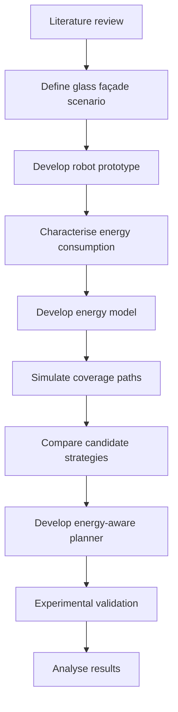

## Project overview

Coverage Path Planning (CPP) determines how a robot traverses a workspace to clean its accessible surface. Conventional methods commonly emphasise **complete coverage and short travel distance**. A robot climbing vertical glass must additionally overcome gravity, maintain suction adhesion, perform turns and operate its cleaning system. As a result, the shortest cleaning route may not be the route with the lowest total energy consumption.

This ME4101A project investigates **energy-aware complete coverage path planning for a low-cost suction-based window-cleaning robot**. The research combines a preliminary robot design, a direction-dependent energy model, Python trajectory simulation and a proposed experimental comparison of coverage strategies.

## Research aim

> Develop and evaluate an energy-aware complete coverage path planning method for a low-cost suction-based window-cleaning robot operating on a vertical glass façade.

## Research objectives

1. Develop a low-cost suction-based wall-climbing cleaning robot.
2. Characterise direction-dependent locomotion and adhesion energy consumption.
3. Develop an energy model incorporating locomotion, adhesion, turning and cleaning.
4. Develop and simulate different complete coverage strategies.
5. Compare conventional and energy-aware CPP using energy consumption, coverage, path length, number of turns and completion time.

## Research approach

This is the **proposed research sequence**, not a claim that every stage has been completed.

## Why energy matters on vertical glass

A wall-climbing robot expends energy not only when travelling but also while holding itself against the surface. Upward, downward and horizontal motion can have different energy costs, and a route with more turns or longer adhesion time may use more energy even if its distance is shorter.

The initial model considered in the report is:

\[
E_{\mathrm{total}}=E_{\mathrm{loc}}+E_{\mathrm{adh}}+E_{\mathrm{turn}}+E_{\mathrm{clean}}
\]

The individual terms and their proposed measurement methods are explained in the [Energy Model](/software/energy-model) page.

## Project scope and current status

The initial research scope is a **flat, rectangular, obstacle-free vertical glass surface**, with a known starting position and suction adhesion. The report mentions a **50 cm × 50 cm physical test panel** in its introduction, while a later methodology draft proposes a **4 m × 6 m operating scenario**. The larger 4 m × 6 m façade is also used as a preliminary Python simulation scenario. These specifications should be reconciled before describing the final experimental apparatus.

::: info Research status
The report documents research motivation, literature findings, a preliminary mathematical energy model and a proposed simulation/experimental methodology. Experimental coefficients, validated comparisons and final performance claims remain to be established.
:::

## Explore the project

- [Research introduction and objectives](/research/)
- [Literature review](/research/literature-review)
- [Research gap and proposed contribution](/research/research-gap)
- [Proposed methodology](/research/methodology)
- [Interactive mechanical CAD model](/design/mechanical)

*Source: ME4101A FYP report, Introduction (pp. 2–3), Literature Review (pp. 3–17), Methodology (pp. 17–19) and Energy Modelling (pp. 19–23).*
