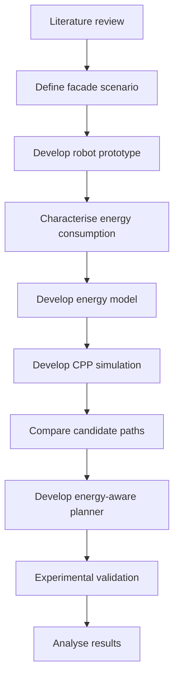

# 3. Proposed System and Research Methodology

This page describes the **planned research workflow** in the report. It separates proposed simulation assumptions and experimental activities from results that have not yet been validated.

## 3.1 Overall research methodology

The research starts by reviewing wall-climbing robot adhesion and CPP literature. A low-cost suction-based prototype is then intended to provide direction-specific movement and adhesion measurements. These measurements will inform an energy model used to compare coverage strategies in Python. Experimental trials are intended to test whether predicted energy differences are reflected in physical operation.

## 3.2 Operating scenario and system requirements

### Initial scenario

The proposed cleaning environment is a flat, vertical, rectangular glass façade without obstacles. The robot starts from a known location and remains attached using suction.

| Parameter | Proposed value or condition | Status |
| --- | --- | --- |
| Simulated façade | 4 m × 6 m | Preliminary Python scenario |
| Cleaning width | 0.3 m | Preliminary simulation assumption |
| Surface orientation | Vertical | Initial scope |
| Obstacles | None | First iteration |
| Starting position | Bottom-left | Methodology draft |
| Adhesion | Continuous suction | Initial modelling assumption |
| Coverage target | 100% | Proposed requirement |
| Robot speed | Constant | Initial simulation assumption |

::: warning Physical test size requires confirmation
The introduction mentions a 50 × 50 cm physical glass panel. The methodology draft also mentions a 4 × 6 m experimental environment. These should not be presented as one confirmed physical setup until the final test arrangement is decided.
:::

### Prototype requirements

The proposed prototype should maintain adhesion, execute planned coverage trajectories, cover the target surface, measure energy consumption, track position and path, and remain low-cost to construct.

## 3.3 Performance metrics

| Metric | Unit | Purpose |
| --- | --- | --- |
| Coverage rate | % | Fraction of target surface cleaned |
| Total energy | J | Electrical energy consumed or predicted |
| Path length | m | Total robot travel distance |
| Redundancy | % | Repeated coverage of previously cleaned regions |
| Number of turns | count | Turning burden |
| Cleaning time | s | Total operation duration |
| Tracking error | m or another defined error measure | Difference between planned and actual trajectory |

## 3.4 Energy characterisation and modelling

The initial mathematical model combines locomotion, adhesion, turning and cleaning:

\[
E_{\mathrm{total}} = e_u D_u + e_d D_d + e_h D_h + P_{\mathrm{adh}}T + N_{\mathrm{turn}}E_{\mathrm{per\ turn}} + P_{\mathrm{clean}}T_{\mathrm{clean}}
\]

Here, \(e_u\), \(e_d\) and \(e_h\) are energy-per-metre coefficients for upward, downward and horizontal movement; \(D_u\), \(D_d\) and \(D_h\) are the respective travelled distances. Adhesion energy depends on suction power and operating time, turning energy depends on turn count and energy per turn, and cleaning energy depends on cleaning power and duration.

The report states that preliminary coefficients are **assumed for framework development** and should later be replaced by experimentally measured values. A proposed electrical measurement method is:

\[
E = \int V(t)I(t)\,dt
\]

The energy coefficients are intended to be determined from directional movement tests, adhesion power measurements and turning tests.

## 3.5 Coverage-path simulation

The report proposes comparing **horizontal sweep, vertical sweep, spiral and reciprocating/boustrophedon** paths. For each path, the Python framework is intended to calculate trajectory, movement direction, travel distance, number of turns, completion time, coverage and estimated energy.

The preliminary simulation assumes a flat obstacle-free façade, constant speed, fixed robot dimensions, fixed cleaning width, continuous adhesion and no slipping. The first simulation does **not** model changing water mass.

## 3.6 Sensitivity analysis

The proposed sensitivity study varies upward, downward and horizontal energy-per-metre coefficients, suction power, energy per turn and robot speed. The objective is to determine whether changes in these assumptions alter the preferred coverage path.

## 3.7 Experimental validation plan

The report proposes physical testing to compare the simulation and robot measurements.

| Variable type | Proposed variables |
| --- | --- |
| Independent | CPP strategy, movement direction, speed |
| Dependent | Energy, time, coverage, tracking error, redundancy |
| Controlled | Surface, robot mass, cleaning width, starting position, battery condition |

A proposed sequence is to measure directional movement energy, vacuum power and turning energy, then run comparable CPP trajectories on the physical robot. The final report should present measured values and differences from simulation only after testing.

## 3.8 Research deliverables and next sections

The methodology leads to the [Robot Design](/design/) documentation, [Energy Model](/software/energy-model), [CPP Algorithms](/software/cpp), [Simulation](/software/simulation) and [Results](/results/) pages.

*Source: FYP report, Sections 3, 5 and 6 (pp. 17–26), with the proposed research sequence on p. 31.*
